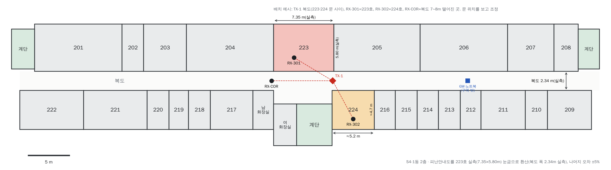

# 수집 장소: S4-1동 2층

- `s4-1_2f_plan.png`: 웹 건물 설정에 올리는 평면도(배치 표시 없음)
- `s4-1_2f_plan_annotated.png`: 치수와 노드 배치 예시가 들어간 팀용 그림
- `make_plan.py`: 위 두 그림을 만든 스크립트(벽 위치 픽셀값과 환산식이 들어 있음)

## 구역과 노드

| 노드 | 구역 | 장면 목록의 이름 |
|---|---|---|
| RX-301 | 223호(스터디룸) | 장면 이름 `*_301`, 설명의 223호 |
| RX-302 | 224호(계단 옆) | 장면 이름 `*_302`, 설명의 224호 |
| RX-COR | 223·224호 앞 복도 | `*_cor` |
| TX-1 | 223호와 224호 문 사이 복도 | |

노드 이름표(RX-301, RX-302)와 장면 이름은 보드 스티커·`nodes.csv`와 맞추려고 그대로 두고, 설명 문구만 실제 방 번호로 바꿨습니다.

## 치수

복도의 피난안내도(축척대로 그려짐)를 사진으로 찍고, 223호 실측값(가로 7.35m, 세로 5.80m)으로 픽셀을 미터로 바꿨습니다. 223호의 사진 속 가로·세로 비율(171:135)이 실측 비율(7.35:5.80)과 같아서 축척이 맞는 것을 확인했습니다. 사진 원근 때문에 ±5% 정도 오차가 있습니다. 복도 폭은 실측(2.34m)으로 바꿨고, 실험에 쓰는 224호도 줄자로 재면 고칩니다.

| 구분 | 값 |
|---|---|
| 건물 길이 | 약 70m(양끝 계단 포함 약 72m) |
| 위 줄 방 깊이(201~208, 223) | 5.80m |
| 복도 폭 | 2.34m(실측, 안내도 환산값 2.25m와 4% 차이) |
| 아래 줄 방 깊이(209~222, 224) | 약 4.8m |
| 223호 | 7.35 × 5.80m(실측) |
| 224호 | 약 5.2 × 4.7m |

위 줄(가로 × 깊이 5.80m): 201 10.7 · 202 2.6 · 203 5.2 · 204 10.7 · 223 7.35 · 205 10.6 · 206 10.7 · 207 5.7 · 208 3.0

아래 줄(가로 × 깊이 약 4.8m): 222 7.8 · 221 7.8 · 220 2.7 · 219 2.4 · 218 2.7 · 217 5.2 · 남자화장실 2.5 · (여자화장실 약 2.8, 계단 약 4.3, 복도 쪽으로 약 1.7m 들어가 있음) · 224 5.2 · 216 2.6 · 215 2.7 · 214 2.6 · 213 2.7 · 212 2.5 · 211 5.4 · 210 2.7 · 209 5.4

천장 높이와 문 위치는 안내도에 없으니 현장에서 적습니다. 판단 코드는 크기를 쓰지 않고, 평면도는 화면 표시와 보고서용입니다.
